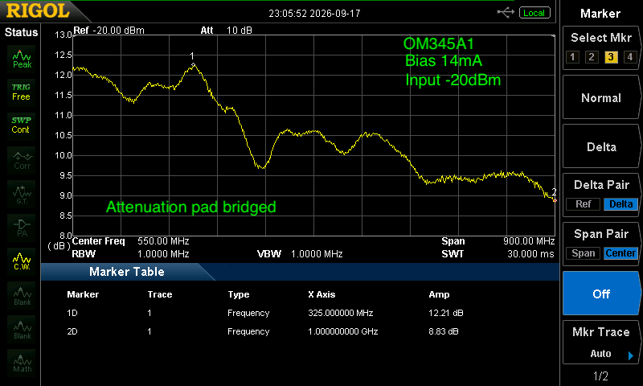
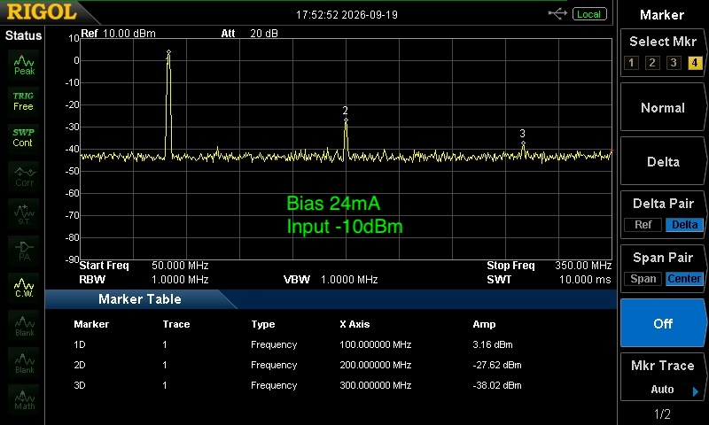
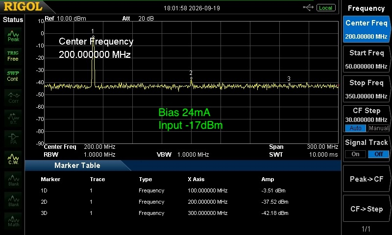
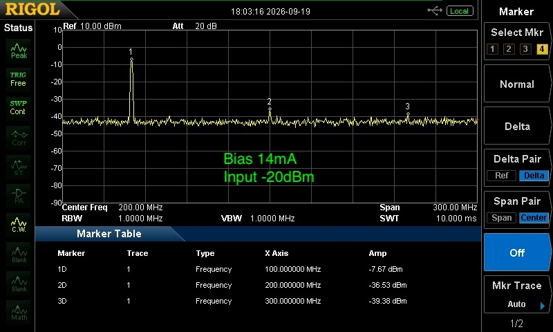

# OM345A1 performance test

The performance tests have been carried out with coax cables soldered to the PCB. The attenuator pad on the input was bridged.

Gain test:

Some attenenuation at higher frequencies would be due to the coax cables connecting the board to the Signal Generator and Spectrum Analyser.

## Harmonics
The amount of bias current influences the Harmonics. Higher bias current means lower Harmonics.

With 24mA bias the 2nd Harmonic appears when the output rises above -12dBm.

WIth 14mA bias then 2 Harmonic appears when the out rises above -17dBm

[Harmonics Tables](OM345A1_Gain+Harmonics.pdf)

### The following graphs show the effect of bias current and input level on harmonics.

